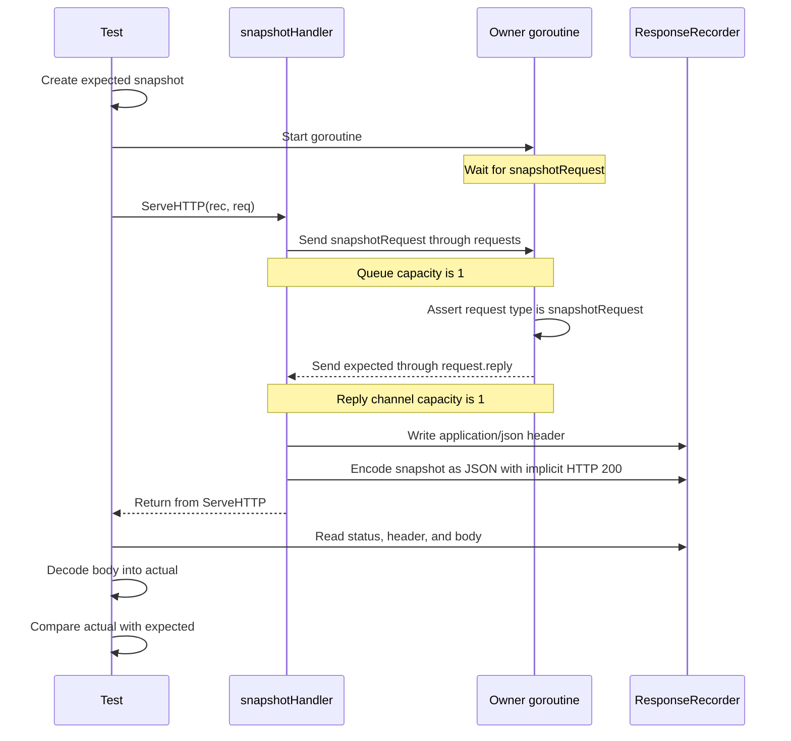

# `TestSnapshotHandlerReturnsOwnerSnapshot` sequence

Тест проверяет обработку snapshot: синтетический GET непосредственно вызывает `snapshotHandler`, обработчик отправляет типизированный `snapshotRequest` владельцу состояния через общую очередь, а полученный `runtimeSnapshot` становится JSON-ответом.

## Участники

- `req` — синтетический `GET /api/loadgen/snapshot`.
- `rec` записывает HTTP-ответ обработчика.
- Горутина владельца состояния заменяет реальный event loop и отвечает на `snapshotRequest`.
- `expected` — готовая структура snapshot, а не предварительно собранный JSON.
- `actual` декодируется из фактического тела HTTP-ответа и сравнивается с `expected`.

Обработчик ждёт ответ через буферный канал `request.reply`. В рабочем приложении отвечает event loop; здесь эту роль выполняет отдельная горутина. Проверки маршрутизации выполняются через ServeMux отдельно: неподдерживаемый метод даёт 405 с `Allow: GET, HEAD`, а реальный HTTP-сервер проверяет HEAD без тела в `TestServeMuxHEADUsesSnapshotAndReturnsNoBody`.

