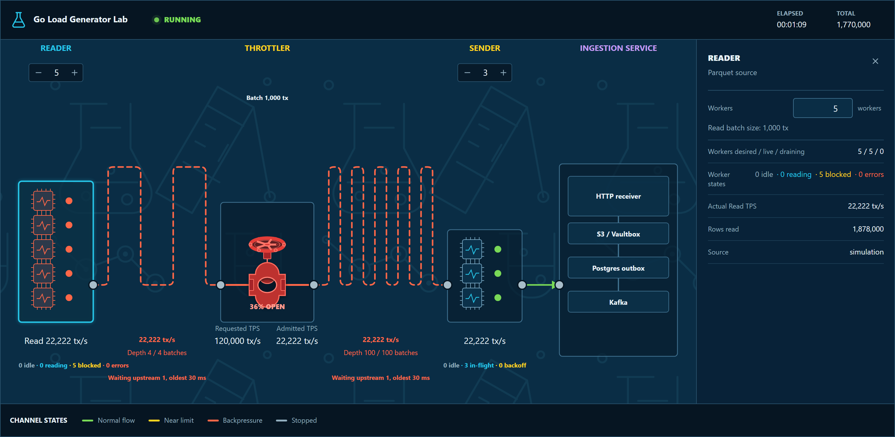

# Ingestion Lab

Ingestion Lab (`ingestion-lab-loadgen`) replays Parquet transactions through a rate-controlled Go pipeline with a React control panel.

[](https://github.com/PainChopper/ingestion-lab-loadgen/actions/workflows/go-ci.yml) · [Live demo (simulation)](https://painchopper.github.io/ingestion-lab-loadgen/) · [Receiver](#receiver) · [LoadGen](#loadgen) · [React UI](#react-ui)



## Why Ingestion Lab?

Change the reader and sender worker counts or the transaction rate while the pipeline is running.
Watch queue occupancy and blocked time to see where backpressure starts.
Start with the browser simulation or run both Go services locally to send real HTTP batches.

## Quick start

Clone the repository. With Go 1.27 and Node.js 24 with npm installed, start each component in a separate terminal. Begin each block at the repository root.

### Receiver

```bash
cd receiver
go run .
```

Receiver listens on `127.0.0.1:8081`, accepts batches at `POST /internal/ingest`, and exposes acceptance counters at [`GET /status`](http://127.0.0.1:8081/status).

### LoadGen

```bash
cd loadgen
go run .
```

LoadGen listens on `127.0.0.1:8080` and automatically starts reading the bundled sample and posting JSON batches to Receiver. The default glob, `../data/MBD-mini/trx/fold=*/*.parquet`, is relative to `loadgen/` and also matches files added in the same layout. To use a personal TOML file outside the checkout, run `go run . serve --config /path/to/loadgen.toml` from `loadgen/`.

### React UI

```bash
cd frontend
npm ci
npm run dev:backend
```

Open the URL Vite prints, usually [localhost:5173/ingestion-lab-loadgen/](http://localhost:5173/ingestion-lab-loadgen/). Vite proxies `/api` to LoadGen. To run the browser simulation locally, use `npm run dev` from `frontend/` after the same install. The simulation generates activity in the browser without a dataset or HTTP delivery.

## Architecture

```text
Parquet → Reader pool → Reader queue → Throttler → Sender queue → Sender pool → HTTP Receiver
```

Readers emit batches of up to the configured size. The Throttler paces whole batches by transaction count, and the Sender retries failed HTTP deliveries. A `204 No Content` acknowledges a batch.

- An event loop serializes run transitions, live commands, and snapshot requests.
- Bounded channels propagate backpressure upstream when the next stage falls behind.
- Monotonic time and cumulative counters let clients calculate rates across polls.
- Strict TOML and control API parsing surface invalid settings and commands.
- Shutdown stops reading and gives pending batches up to ten seconds to drain.

See [architecture decisions](docs/decisions.md) for the tradeoffs.

## Reference

- [Configuration](docs/configuration.md) for TOML settings, delivery, and shutdown.
- [HTTP API](docs/api.md) for snapshots, commands, and CLI examples. Open [Swagger UI](http://127.0.0.1:8080/developer/swagger/ui/) while LoadGen is running.
- [Observability](docs/observability.md) for Prometheus metrics, Go profiling, and the Prometheus/Grafana Compose stack in [`infra/`](infra/docker-compose.yml).
- [Testing](docs/testing.md) for Go and frontend checks.

## Code and data

The code is [MIT licensed](LICENSE). The repository includes one original, unmodified MBD-mini Parquet file. The full [MBD-mini dataset on Hugging Face](https://huggingface.co/datasets/ai-lab/MBD-mini) is by sb-ai-lab and licensed under [CC BY 4.0](https://creativecommons.org/licenses/by/4.0/). See the [data NOTICE](data/MBD-mini/trx/fold=0/NOTICE) and [arXiv:2409.17587](https://arxiv.org/abs/2409.17587).

The project is developed with AI assistance. The author is responsible for engineering decisions, code review, and acceptance.
